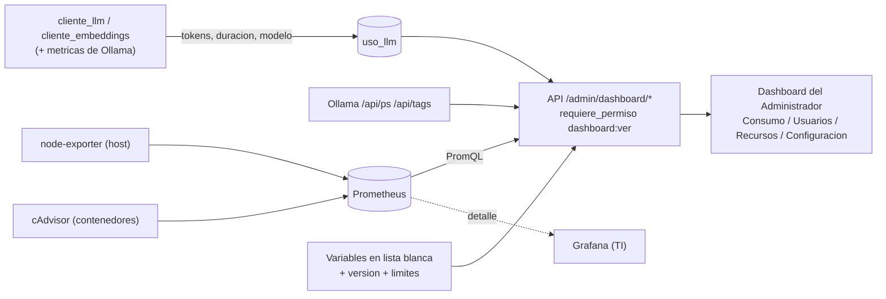

# 06 · Análisis — Dashboard del Administrador: consumo de tokens, recursos y configuración

Versión 0.1 · 2026-10-12 · Relacionado con: RF-21, RF-22, RNF-11, RNF-15, RNF-16, RNF-17, RNF-18, ADR-009, docs/05-prompts/P-13-dashboard-administrador-consumo.md

## Antecedentes

El diagnóstico completo está en P-13 §1 (no se repite aquí). En resumen: Ollama devuelve tokens y duraciones en cada respuesta pero `rag/cliente_llm.py`/`rag/cliente_embeddings.py` los descartan; Prometheus apunta a `/metrics` que no existen; no hay `node-exporter` ni `cAdvisor`; no hay librería de gráficos en la UI. P-12 (roles en base de datos, `requiere_permiso`) ya está completo -- es la dependencia declarada de P-13.

## Objetivo general

Que el Administrador vea, desde una sola pantalla, cuánto trabaja el agente, quién y qué lo consume, cómo están los recursos del servidor, y con qué configuración corre -- sin exponer secretos ni depender de que alguien sepa leer Grafana/PromQL.

## Objetivos específicos

1. Registrar cada llamada al LLM y a embeddings (tokens, duración, modelo, usuario, caso de uso, resultado) sin frenar ni romper el análisis si el registro falla (RNF-16).
2. Mostrar consumo agregado por servidor, usuario, área, caso de uso y modelo, con rango de fechas y exportación CSV.
3. Mostrar CPU/memoria/disco del host y de cada contenedor, y los modelos cargados en Ollama, actualizado cada 30 s.
4. Mostrar la configuración vigente mediante una lista blanca explícita -- nunca una variable con `PASSWORD`/`SECRET`/`KEY`/`TOKEN` (RNF-18).
5. Alertar cuando el disco se acerca al límite (≥ 70 %, R-07) o crecen los timeouts del LLM (> 10 % en 24 h).

## In-Scope / Out-of-Scope

| In-Scope | Out-of-Scope |
| --- | --- |
| Tabla `uso_llm` (Postgres de negocio) y endpoints de consumo/usuarios con filtros y CSV | Costo monetario (modelos locales: se reporta capacidad, no dinero) |
| `node-exporter` + `cAdvisor` (ADR-009), scrape cada 30 s, retención 15 días | Reemplazar Grafana (sigue como vista detallada para TI) o Langfuse (complementario, ver ADR-009) |
| Estado de Ollama (`/api/ps`, `/api/tags`) | Cambiar configuración desde el dashboard (solo lectura) |
| Configuración vigente en lista blanca | Alertas por correo/chat (fase posterior) |
| Gráficos en SVG propio (barras, línea), sin librerías nuevas | Datos de consumo anteriores a la instalación de `uso_llm` |

## RF/RNF afectados

**Nuevos** (no existían en el SRS v0.6/v0.9): RF-21 (registrar uso de LLM/embeddings), RF-22 (dashboard de consumo y recursos tras el permiso `dashboard:ver`), RNF-15 (sobrecarga de registro ≤ 20 ms), RNF-16 (dashboard ≤ 2 s con 100,000 registros), RNF-17 (lista blanca de configuración, nunca secretos), RNF-18 (exportadores sin acceso de escritura al host, red interna, sin internet). **Reutiliza** RNF-11 (observabilidad, ya en el SRS pero nunca implementada -- este trabajo es, en esencia, cumplirla), RNF-04/RNF-05 (umbrales de rendimiento que el dashboard ayuda a vigilar), RNF-06 (trazabilidad, mismo espíritu que `uso_llm`).

[POR CONFIRMAR] **Numeración**: P-13 §5 propone RF-25/RF-26 y RNF-16..19, pero el SRS vigente solo llega a RF-20/RNF-14 -- se usan aquí RF-21/RF-22 y RNF-15..18 (la siguiente numeración libre real) para no dejar un hueco RF-21..24/RNF-15; a confirmar con el responsable del proyecto en la próxima revisión del SRS.

[POR CONFIRMAR] **CU**: el SRS no define un caso de uso para administración/observabilidad transversal (mismo vacío ya señalado para RF-02/RF-18/RF-20 en la matriz de trazabilidad) -- este dashboard no se asigna a un CU existente para no forzarlo; queda sin CU dedicado, igual que esos tres RF.

## Riesgos

Ver `docs/02-analisis/03-riesgos.md` (R-12 a R-16, agregados en este bloque): exponer un secreto en "Configuración" por error en la lista blanca (mitigado con prueba automática que falla si aparece un valor marcado como secreto en `.env`), `node-exporter`/`cAdvisor` necesitan montajes de solo lectura del host (mitigado: sin escritura, sin puertos publicados, red interna, ADR-009), el registro de uso podría frenar un análisis si no se aísla bien (mitigado: inserción fuera de la ruta crítica, con `try/except` que nunca propaga), cifras de tokens de embeddings no disponibles según la versión de Ollama (mitigado: se registra `NULL`/"no informado", nunca se estima), más carga en la VM de stage por el scraping (mitigado: intervalo de 30 s, retención de 15 días).

## Flujo

