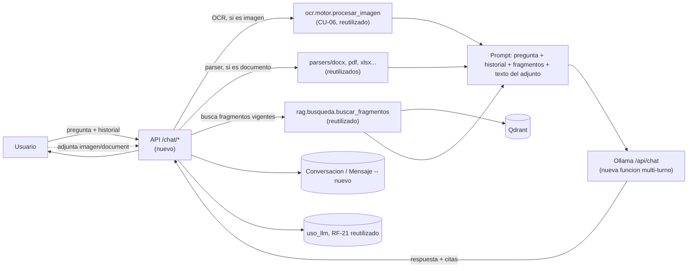

# 07 · Análisis — Chat de la Base de Conocimiento

Versión 0.1 · 2026-10-13 · Relacionado con: RF-23, RF-24, RNF-19, CU-12, HU-31..34, docs/05-prompts/P-14-chat-base-conocimiento.md

## Antecedentes (diagnóstico del código al 2026-10-13)

| Tema | Situación actual | Evidencia |
| --- | --- | --- |
| Recuperación (RAG) | `rag/busqueda.py::buscar_fragmentos` ya existe, filtra solo fragmentos `estado="vigente"`, ordena por prioridad y similitud, y `construir_citas` arma el texto citable -- reutilizable tal cual para el chat | `src/rag/busqueda.py` |
| Generación del LLM | `rag/cliente_llm.py` ya llama a `/api/chat` de Ollama, pero el wrapper Python (`generar_texto`/`generar_texto_con_metricas`) siempre manda un único mensaje `role: user` -- no acepta una lista de mensajes con historial | `src/rag/cliente_llm.py` |
| Multi-turno | No existe en ningún punto del proyecto: ningún llamador actual pasa historial de conversación al LLM | `orquestador/`, `validadores/`, `ortografia/` (todos de una sola pasada) |
| Adjuntos (imagen) | `ocr/motor.py::procesar_imagen` es una función pura, invocable directo sobre una imagen ya decodificada, sin pasar por Celery ni crear un `Analisis` | `src/ocr/motor.py` |
| Adjuntos (documento) | `parsers/docx.py`, `pdf.py`, `xlsx.py`, `pptx.py`, `markdown.py` ya extraen texto por formato; `curaduria/extraccion.py::extraer_fragmentos` es un dispatcher existente pero limitado a docx/pdf/md | `src/parsers/`, `src/curaduria/extraccion.py` |
| Modelo de datos | No existe ninguna tabla de conversación/mensaje -- hay que crearla | `src/comun/modelos.py` |
| Pantalla de inicio | `"/"` hoy es `NuevoAnalisis.tsx`, sin gate de permiso en la ruta (el formulario de carga se oculta sin `analisis:crear`, pero la ruta en sí es accesible a cualquier sesión) | `src/ui/src/App.tsx`, `src/ui/src/paginas/NuevoAnalisis.tsx` |

## Objetivo general

Que cualquier usuario autenticado pueda preguntarle al agente, en lenguaje natural y en una conversación con memoria, sobre la Base de Conocimiento vigente (la misma que ya usan CU-01/CU-02/CU-03/CU-04/CU-05 para citar reglas y normativa), con respuestas citadas y sin inventar cuando no hay información -- y que pueda adjuntar una imagen o un documento puntual a su pregunta sin que eso dependa del flujo formal de curaduría de CU-08. Todo 100 % local (RNF-01): ninguna llamada externa.

## Objetivos específicos

1. Responder preguntas en lenguaje natural usando `rag/busqueda.py` (RF-23), citando fuente/versión/sección igual que el resto del sistema (RNF-06).
2. Sostener una conversación de varios turnos, no solo preguntas sueltas (requiere extender `cliente_llm.py` para aceptar historial de mensajes).
3. Permitir adjuntar una imagen (vía OCR, CU-06) o un documento (Word/PDF/Excel, vía `parsers/`) a una pregunta puntual, sin agregar ese contenido a la Base de Conocimiento permanente (RF-24).
4. Que el chat sea la pantalla de inicio por defecto para todos los roles, sin reemplazar "Nuevo análisis" (que se mueve a su propia ruta).
5. Guardar el historial de conversaciones por usuario (cada quien ve solo el suyo, RNF-19), para poder retomarlas.

## In-Scope / Out-of-Scope

| In-Scope | Out-of-Scope |
| --- | --- |
| Preguntas en lenguaje natural sobre la Base de Conocimiento vigente, con citas | Agregar contenido nuevo a la Base de Conocimiento desde el chat (eso sigue siendo CU-08, con su flujo de aprobación) |
| Conversación multi-turno con historial persistido por usuario | Chat entre usuarios (humano-humano); esto es siempre usuario-agente |
| Adjuntar una imagen (OCR) o un documento (Word/PDF/Excel) para esa pregunta puntual | Modelo de visión (multimodal) -- las imágenes se procesan con el motor de OCR ya existente, no con un modelo nuevo que "vea" la imagen directamente |
| Nueva pantalla de inicio ("/") con el chat, para todos los roles | Tocar los permisos o el flujo de CU-01 a CU-08 existentes |
| Registro de uso del LLM del chat en `uso_llm` (ya existe desde P-13, RF-21) | Reemplazar el buscador/RAG usado dentro de un análisis (CU-01..05) -- el chat es una capacidad nueva y separada |

## Decisión de diseño: por qué CU-12 y no ampliar CU-08

CU-08 ("Gestionar base de conocimiento") es, en el SRS, exclusivamente curaduría: cargar, versionar, aprobar fuentes y mantener el glosario (HU-11). No tiene ningún escenario de "preguntar"/"consultar" en lenguaje natural -- lo único parecido es el uso del RAG **dentro** de un análisis de CU-01 a CU-05 para citar una fuente, que no es una interfaz de consulta independiente. "Consultar la base de conocimiento por chat" es una capacidad de negocio distinta (un actor distinto puede querer usarla sin ser Curador), así que se propone como **CU-12** (CU-11 sigue reservado y sin aprobar para otra iniciativa, "estructura de hojas de cálculo" -- no se reutiliza ese número).

## RF/RNF afectados

**Nuevos**: RF-23 (consultas conversacionales sobre la Base de Conocimiento), RF-24 (adjuntar imagen/documento a una pregunta del chat), RNF-19 (aislamiento del chat: sin internet, historial por usuario). **Reutiliza**: RNF-01 (privacidad/sin internet, ya se cumple reusando Ollama/Qdrant locales), RNF-03 (el LLM no inventa cifras/reglas -- acá se traduce a "no inventar si no hay fragmentos"), RNF-06 (trazabilidad, mismas citas que ya usa el resto del sistema), RF-21 (el uso del LLM del chat también se registra en `uso_llm`, visible en el Dashboard del Administrador).

[POR CONFIRMAR] **Numeración**: se usó la siguiente numeración libre real tras P-13 (RF-23/RF-24, RNF-19, HU-31..34, R-17..19, CU-12) -- a confirmar con el responsable del proyecto en la próxima revisión del SRS, igual que se señaló para P-13.

## Decisiones de diseño pendientes de confirmar con el usuario antes del Bloque 1

1. **Persistencia del historial**: se propone crear `Conversacion` (usuario_id, fecha_creacion) y `Mensaje` (conversacion_id, rol `user`/`assistant`, contenido, fecha, fragmentos citados) en `comun/modelos.py` -- no existe nada reutilizable hoy. Alternativa más simple (sin persistir, solo en memoria del navegador) queda descartada porque HU-34 pide poder retomar conversaciones.
2. **Reescritura de preguntas de seguimiento**: una pregunta como "¿y en el área de Legal?" no tiene sentido como consulta de embeddings sin el contexto previo. Se propone, en una primera versión, incluir los últimos N turnos como contexto del prompt final (sin una reescritura explícita de la consulta antes de buscar en Qdrant) -- más simple, con la limitante de que la búsqueda semántica usa solo el último mensaje del usuario. Mejorar esto (reescritura explícita) queda como posible iteración 2 si la calidad no es suficiente.
3. **Extensión de `cliente_llm.py`**: se propone una función nueva (p. ej. `generar_respuesta_chat(mensajes: list[dict], ...)`) en vez de modificar `generar_texto_con_metricas`, para no arriesgar al resto de llamadores existentes (CU-01/02/05/06) que dependen de su contrato actual de un solo `prompt: str`.
4. **Adjuntos**: el texto extraído (OCR o parser) se agrega al prompt de esa pregunta puntual, nunca se indexa en Qdrant ni se guarda como `FuenteConocimiento` -- evita el riesgo R-18 por diseño, no por validación posterior.

## Riesgos

Ver `docs/02-analisis/03-riesgos.md` (R-17 a R-19, agregados en este análisis): el chat responde sin fundamento si no hay fragmentos relevantes (mitigado con el mismo criterio de "no inventar" de RNF-03), un adjunto efímero se mezcla con la base de conocimiento permanente (mitigado por diseño: nunca se indexa), y el historial de conversaciones crece sin control o expone información entre usuarios (mitigado: cada usuario ve solo el suyo, misma política de retención que el resto del sistema).

## Flujo

