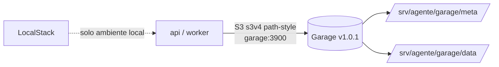

# ADR-006 — Almacenamiento de objetos: LocalStack en local, Garage en stage

**Versión:** 2.0
**Fecha:** 2026-10-13 (v1.0: 2026-09-25)
**Relacionado con:** RF-03, RN-09, RNF-01, ADR-004, ADR-005, docs/03-diseno/c4/02-contenedores.md, docs/04-pruebas/resultados/local-localstack.md, docs/05-prompts/P-15-aprobacion-fuentes-y-garage.md

## Estado

Aceptado para local (LocalStack) y para stage (**Garage v1.0.1**). Reemplaza la parte "pendiente" de la v1.0.

## Contexto

MinIO Inc. descontinuó toda distribución gratuita (imagen Docker, `bitnami/minio`, `quay.io` y binario: ver v1.0 en el historial de Git). Para local se adoptó LocalStack (solo S3). En v1.0 quedó pendiente elegir el backend de stage entre SeaweedFS y Garage.

**Evidencia de stage (2026-10-13, lab-ia-01):** LocalStack **perdió objetos al reiniciar** pese a `PERSISTENCE=1`, lo que dejó fuentes aprobadas sin archivo en el almacenamiento (descarga fallida en `comun/almacenamiento.py::descargar_objeto`). Se migró a Garage v1.0.1 (`dxflrs/garage`) y se probó:

| Prueba | Resultado |
| --- | --- |
| Persistencia de objetos tras reinicio del contenedor | OK |
| Carga multiparte de 1 GB | OK |
| Compatibilidad con `comun/almacenamiento.py` (boto3/botocore 1.35.99, firma s3v4, `addressing_style=path`, región `us-east-1` con `s3_region=us-east-1` en Garage) | OK, sin cambios de código |

## Decisión

1. **Stage:** se usa **Garage v1.0.1** como almacenamiento de objetos S3-compatible, un solo nodo, datos y metadatos en `/srv/agente/garage/{data,meta}`, sin puertos publicados (solo `red_interna`, endpoint `garage:3900`).
2. **Local:** se conserva LocalStack (sin cambios).
3. **SeaweedFS** queda como alternativa documentada **si se escala a varios nodos** (replicación/erasure coding a mayor escala); no se implementa ahora.
4. El `rpc_secret` de Garage se genera por ambiente y **nunca** se versiona; el repositorio solo contiene `infra/garage/garage.toml.example`.
5. La inicialización (layout, llave de acceso, buckets `conocimiento` y `documentos`) se hace con un script idempotente, `infra/scripts/inicializar-garage.sh`.
6. Las variables mantienen el prefijo `MINIO_*` (p. ej. `MINIO_ENDPOINT=garage:3900`) para no dispersar el cambio; el renombrado es opcional y futuro.

## Alternativas consideradas

| Alternativa | Resultado |
| --- | --- |
| LocalStack en stage | Descartada: perdió objetos al reiniciar con persistencia activa. |
| SeaweedFS | Vigente como alternativa para multi-nodo; configuración más compleja, innecesaria para un nodo. |
| MinIO / bitnami / quay.io | Descartadas (ver v1.0). |

## Consecuencias

- `infra/compose.stage.yml`: servicio `garage` (imagen fijada, `garage.toml` en solo lectura); se retira `localstack` de stage. Detalle en el Bloque 5 de P-15.
- Garage es AGPLv3 y de comunidad más pequeña; se mitiga con respaldo de `/srv/agente/garage` y la versión fijada.
- Los permisos de `/srv/agente` se documentan en `docs/06-operacion` (Prometheus uid 65534, Grafana uid 472).
- Se evita el 409 por objeto ausente (Bloque 1 de P-15) como degradación controlada, no como sustituto de la persistencia.
