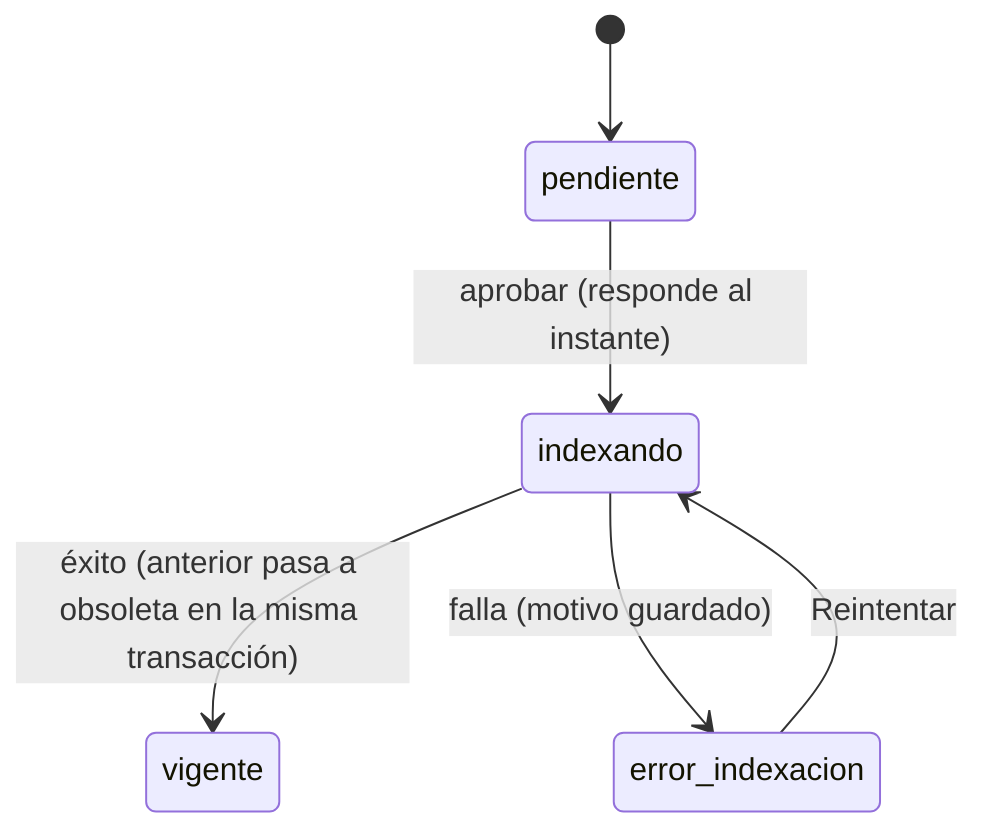

# ADR-010 — Indexación asíncrona y fragmentación de fuentes

**Versión:** 1.0
**Fecha:** 2026-10-13
**Relacionado con:** RF-21, RNF-01, CU-08, ADR-001, ADR-006, ADR-008, docs/05-prompts/P-15-aprobacion-fuentes-y-garage.md

## Estado

Aceptada. Implementada en los bloques 1 a 6 de P-15; pendiente la validación con datos reales en stage (reindexar CONT-006 y CONT-007).

## Contexto

En stage (CPU sin AVX, 8 vCPU, `OLLAMA_NUM_PARALLEL=1`), aprobar una fuente falla con 500:

- `curaduria/extraccion.py::extraer_fragmentos` corta por sección/página **sin tope**: se vieron fragmentos de 4,089 tokens. Ollama responde "input too large (batch 2048)" y trunca a 2,048 tokens (pérdida silenciosa de contenido).
- `indexar_fuente` corre **dentro de la petición HTTP** y llama un embedding por fragmento con timeout fijo de 30 s; un embedding con Ollama ocupado tardó 173.8 s → `httpx.ReadTimeout` → 500 sin cabeceras CORS (el navegador lo reporta como error de CORS y la UI queda en "Aprobando…").

## Decisión

1. **Errores visibles:** manejador global de excepciones que devuelve `{error, detalle}` con cabeceras CORS también en 500; objeto ausente en S3 → 409 con mensaje accionable.
2. **Fragmentación acotada:** dentro de cada sección/página se divide por párrafos con tope `FRAGMENTO_MAX_TOKENS=450` y solapamiento `FRAGMENTO_SOLAPE_TOKENS=60` (configurables). Se conservan `fuente_id`, `version`, `seccion`, `pagina`. Se limpian líneas de índice con puntos guía, encabezados/pies repetidos y caracteres de control. Nunca se envía a embeddings más del tope. El tope deja holgura bajo el batch de 2,048 de Ollama y acorta cada llamada.
3. **Embeddings robustos:** `EMBEDDINGS_TIMEOUT_S` (300 por defecto), lotes en `/api/embed` con `input` lista (`EMBEDDINGS_LOTE`=16), 3 reintentos con espera, `keep_alive` para bge-m3; `uso_llm` registra por lote.
4. **Aprobación asíncrona:** aprobar responde de inmediato con estado `indexando` y encola una tarea Celery.

   El progreso "fragmento N de M" se guarda en la fuente y es consultable; cada transición se registra en la bitácora.

5. **Cola y worker dedicados:** la tarea `orquestador.tareas.indexar_fuente_conocimiento` va a la cola `indexacion`, que consume el servicio `worker_indexacion` (concurrencia 1). Así una indexación larga no ocupa los workers de CU-01, CU-02 y CU-05.
6. **Orden de la transición:** los puntos se indexan en Qdrant con `estado="indexando"`; al terminar, en una sola transacción de Postgres la versión anterior pasa a obsoleta y la nueva a vigente, y se actualizan los payloads (primero lo nuevo, después lo viejo). Mientras indexa, la versión anterior sigue vigente y buscable. Reintentar borra los fragmentos y puntos del intento previo (idempotente).

## Alternativas consideradas

| Alternativa | Por qué se descarta |
| --- | --- |
| Solo subir el timeout | No evita el truncado a 2,048 tokens ni bloquea menos la API; una fuente grande seguiría ocupando un worker HTTP durante minutos. |
| Fragmentos más grandes y subir `num_batch` | Más memoria/latencia por llamada en CPU sin AVX; peor recuperación (RAG prefiere fragmentos acotados). |
| Hilo en la API en vez de Celery | Pierde reintentos y estado ante reinicio; ya existe worker Celery en el proyecto. |

## Consecuencias

- Nuevo estado `indexando`/`error_indexacion` en fuentes: requiere migración Alembic y ajustes de UI (botón Reintentar).
- Las fuentes ya indexadas con fragmentos grandes deben **reindexarse** (CONT-006, CONT-007).
- Riesgo a vigilar en el Bloque 3: no alterar el flujo de CU-01/CU-05 ni el chat de P-14, que comparten el cliente de embeddings y la búsqueda; si hay riesgo se avisa antes de implementar.
