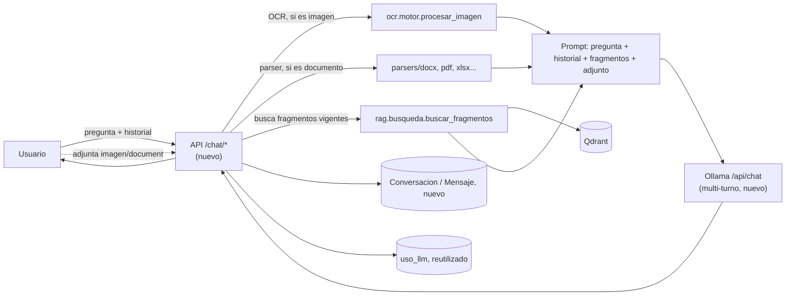

# P-14 · Chat de la Base de Conocimiento

Versión 1.0 · 2026-10-13 · Ejecutor: Claude Code · Depende de: **CU-08** (Base de Conocimiento ya indexada) · Trazabilidad: RF-23, RF-24, RNF-19, CU-12, HU-31..34, R-17..19

## 1. Antecedentes (diagnóstico del código al 2026-10-13)

Ver `docs/02-analisis/07-analisis-chat-base-conocimiento.md` (no se repite aquí). En resumen: `rag/busqueda.py` ya recupera fragmentos vigentes y citables, pero no hay ningún chat ni soporte de historial multi-turno en `rag/cliente_llm.py` (siempre manda un único mensaje `user`); el motor de OCR (`ocr/motor.py::procesar_imagen`) y los parsers de documentos ya existen y son reutilizables directamente, sin pasar por Celery; no existe ninguna tabla de conversación/mensaje.

## 2. Objetivos

**General:** que cualquier usuario autenticado pueda conversar con el agente sobre la Base de Conocimiento vigente, con respuestas citadas y sin inventar, pudiendo adjuntar una imagen o un documento puntual a su pregunta -- sin salir a internet.

**Específicos**
1. Responder preguntas en lenguaje natural usando el RAG ya existente, citando fuente/versión/sección.
2. Sostener una conversación de varios turnos con memoria.
3. Permitir adjuntar una imagen (OCR) o un documento (Word/PDF/Excel) a una pregunta puntual, sin agregarlo a la Base de Conocimiento permanente.
4. Que el chat sea la pantalla de inicio por defecto, para todos los roles; "Nuevo análisis" se mueve a su propia ruta.
5. Guardar el historial de conversaciones por usuario (cada quien ve solo el suyo).

## 3. Alcance

| In-Scope | Out-of-Scope |
| --- | --- |
| Preguntas en lenguaje natural sobre la Base de Conocimiento vigente, con citas | Agregar contenido nuevo a la Base de Conocimiento desde el chat (sigue siendo CU-08) |
| Conversación multi-turno con historial persistido por usuario | Chat humano-humano |
| Adjuntar imagen (OCR) o documento (Word/PDF/Excel) para esa pregunta puntual | Modelo de visión/multimodal nuevo |
| Nueva pantalla de inicio ("/") con el chat, para todos los roles | Tocar permisos o el flujo de CU-01 a CU-08 existentes |
| Registro del uso del LLM del chat en `uso_llm` (RF-21, ya existe) | Reemplazar el RAG usado dentro de un análisis (CU-01..05) |

## 4. Historias de usuario

| ID | Historia | Criterios de aceptación |
| --- | --- | --- |
| HU-31 | Como cualquier usuario, quiero preguntar en lenguaje natural sobre la base de conocimiento | Respuesta citada cuando hay fragmentos vigentes relevantes; "no tengo información sobre esto" cuando no los hay; usa el contexto de la conversación en preguntas de seguimiento |
| HU-32 | Como usuario del chat, quiero adjuntar una imagen o documento a mi pregunta | El agente extrae el texto (OCR o parser) y lo usa para responder esa pregunta puntual; el archivo no aparece después en la Base de Conocimiento (CU-08) |
| HU-33 | Como cualquier usuario, quiero que el chat sea mi pantalla de inicio | Llego al chat al iniciar sesión, sin importar el rol; "Nuevo análisis" sigue disponible en el menú para quien tiene `analisis:crear` |
| HU-34 | Como usuario del chat, quiero ver mis conversaciones anteriores | Lista de mis conversaciones (no las de otro usuario); puedo retomar una y seguir preguntando con su contexto |

## 5. Requerimientos

| Tipo | ID | Requerimiento |
| --- | --- | --- |
| RF | RF-23 | Permitir consultas conversacionales en lenguaje natural sobre la Base de Conocimiento vigente, citando la fuente |
| RF | RF-24 | Permitir adjuntar una imagen o documento a una consulta del chat, sin agregarlo a la Base de Conocimiento permanente |
| RNF | RNF-19 | El chat no origina ninguna llamada externa ni a internet; cada usuario solo ve su propio historial de conversaciones |

## 6. Stack y diseño

FastAPI + SQLAlchemy + Alembic (tablas nuevas `conversacion`/`mensaje`), reutiliza `rag/busqueda.py` (recuperación), `ocr/motor.py` (OCR de adjuntos), `parsers/*` (texto de documentos adjuntos), Ollama `/api/chat` (ya en uso, se extiende para aceptar historial), React (pantalla nueva, sin librerías de chat externas -- lista simple de mensajes).



**Modelo de datos nuevo:**
- `conversacion`: id, usuario_id, fecha_creacion, titulo (derivado del primer mensaje, o `[POR CONFIRMAR]` editable).
- `mensaje`: id, conversacion_id, rol (`user`/`assistant`), contenido, fecha_hora, fuentes_citadas (JSON, opcional -- fuente_id/versión/sección de los fragmentos usados en esa respuesta).

## 7. Riesgos

| ID | Riesgo | Mitigación |
| --- | --- | --- |
| R-17 | El chat responde sin fundamento si no hay fragmentos relevantes | Mismo criterio de "no inventar" de RNF-03: responder que no hay información si ningún fragmento supera el umbral de similitud |
| R-18 | Un adjunto efímero se mezcla con la base de conocimiento permanente | El texto del adjunto nunca se indexa en Qdrant ni se guarda como `FuenteConocimiento` -- por diseño, no por validación posterior |
| R-19 | El historial de conversaciones crece sin control o expone información entre usuarios | Cada usuario ve solo el suyo (como `historial:propio`); misma política de retención que el resto de datos del sistema |

## 8. Prompt (pegar en Claude Code)

```xml
<tarea>Implementa el Chat de la Base de Conocimiento según docs/05-prompts/P-14-chat-base-conocimiento.md. El diagnóstico está en la sección 1 y en docs/02-analisis/07-analisis-chat-base-conocimiento.md; no lo repitas. Responde en español. Detente al final de cada bloque y espera mi visto bueno.</tarea>

<contexto>
rag/busqueda.py ya recupera fragmentos vigentes y citables (buscar_fragmentos, construir_citas) -- reutilízalo tal cual. rag/cliente_llm.py llama a Ollama /api/chat pero siempre manda un único mensaje "user"; agrega una función nueva que acepte una lista de mensajes (historial) sin romper a quien ya usa generar_texto/generar_texto_con_metricas. ocr/motor.py::procesar_imagen y los parsers de src/parsers/ ya son reutilizables directamente, sin pasar por Celery ni crear un Analisis -- úsalos para los adjuntos, cuyo texto nunca se indexa en Qdrant ni se guarda en la Base de Conocimiento permanente. No existe ninguna tabla de conversación/mensaje: créala.
</contexto>

<bloque id="1" nombre="Modelo de datos y generación multi-turno">
1. Migración: tablas conversacion y mensaje (ver sección 6), con índices por usuario_id/conversacion_id.
2. rag/cliente_llm.py: función nueva para generar una respuesta a partir de una lista de mensajes (historial), reutilizando el mismo transporte /api/chat y el mismo registro de métricas (MetricasOllama) que ya existe -- sin tocar el contrato de generar_texto/generar_texto_con_metricas.
3. Pruebas: una conversación con 2+ turnos genera un prompt que incluye el historial; las métricas se registran igual que con un prompt de una sola pasada.
</bloque>

<bloque id="2" nombre="API del chat">
1. POST /chat/conversaciones -- crea una conversación nueva.
2. GET /chat/conversaciones -- lista las conversaciones del usuario autenticado (nunca las de otro).
3. GET /chat/conversaciones/{id} -- mensajes de una conversación propia (404/403 si es de otro usuario).
4. POST /chat/conversaciones/{id}/mensajes -- pregunta nueva (texto, con un adjunto opcional: imagen o documento). Flujo: si hay adjunto, extrae su texto (OCR o parser según el tipo); busca fragmentos vigentes con rag.busqueda; arma el prompt final (pregunta + historial + fragmentos + texto del adjunto si lo hay); genera la respuesta; guarda ambos mensajes (user y assistant, con las fuentes citadas); registra el uso en uso_llm (caso_uso="chat_kb", reutilizando comun/uso_llm.py).
5. Si no hay fragmentos relevantes, la respuesta dice explícitamente que no hay información en la base de conocimiento -- nunca inventa (R-17).
6. Pruebas: pregunta con fragmentos relevantes cita la fuente; pregunta sin fragmentos relevantes no inventa; un adjunto se usa para esa respuesta pero no queda en ninguna tabla de la Base de Conocimiento; GET /chat/conversaciones/{id} de otro usuario da 403/404.
</bloque>

<bloque id="3" nombre="Pantalla">
1. Nueva pantalla de chat en "/", para todos los roles (sin gate de permiso, como Historial hoy). Lista de mensajes, caja de texto, botón de adjuntar (imagen o documento), lista de conversaciones anteriores para retomar.
2. "Nuevo análisis" se mueve a una ruta propia (p. ej. /nuevo-analisis) con su misma entrada de menú y el mismo permiso analisis:crear que ya tiene; decide qué pasa con el panel de "Análisis recientes" que hoy vive dentro de NuevoAnalisis.tsx (¿se muda a Historial, a la nueva pantalla de Nuevo análisis, o a ambas?) y documenta la decisión.
3. Accesible (WCAG AA, igual que el resto del proyecto): mensajes con el rol indicado (no solo color), foco visible, formulario operable por teclado.
4. Pruebas: cambiar las rutas no rompe los specs E2E existentes (menu-por-rol.spec.ts, accesibilidad.spec.ts) -- actualízalos si hace falta.
</bloque>

<bloque id="4" nombre="Pruebas y cierre">
Permisos: el chat es accesible a todos los roles autenticados (no hay 403 propio); la separación por usuario de las conversaciones si (ningún usuario ve las de otro). Sin fugas: un adjunto nunca aparece en la Base de Conocimiento. Rendimiento: igual criterio que RNF-15 (el registro de uso del chat no agrega más de 20 ms). Actualiza plan-pruebas, estado-proyecto, docs/06-operacion (si aplica) y el guion de demo.
</bloque>

<reglas>TDD. Un commit por bloque (Conventional Commits) y push. Sin secretos en el repositorio. No mostrar archivos completos en el chat.</reglas>
<salida_en_chat>Por bloque: tabla ruta · cambio · prueba (ok/falla) · métrica · "¿Continúo con <siguiente>?".</salida_en_chat>
```

## 9. Definición de terminado

- Cualquier usuario autenticado puede preguntar en lenguaje natural sobre la Base de Conocimiento vigente y recibe una respuesta citada, o un "no tengo información" explícito si no hay fragmentos relevantes.
- Puede adjuntar una imagen o un documento a su pregunta, sin que ese archivo quede en la Base de Conocimiento permanente.
- El chat sostiene una conversación con memoria y guarda el historial por usuario, sin exponer el de otros.
- El chat es la pantalla de inicio para todos los roles; "Nuevo análisis" sigue disponible en su propia ruta.
- No se origina ninguna llamada externa ni a internet.
