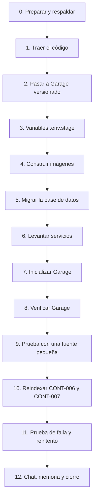

# Guía paso a paso — Desplegar P-15 en stage (lab-ia-01)

**Versión:** 1.0
**Fecha:** 2026-10-14
**Relacionado con:** docs/05-prompts/P-15-aprobacion-fuentes-y-garage.md, ADR-006 v2, ADR-010, docs/04-pruebas/resultados/stage-P15.md, docs/06-operacion/traslado-stage-paso-a-paso.md, docs/06-operacion/configuracion-env-stage.md

Para quien opera stage. Esta guía despliega los cambios de P-15 sobre un stage que **ya funciona** (Ollama con los 3 modelos, Postgres, Qdrant, Garage probado a mano) y termina reindexando CONT-006 y CONT-007. No reemplaza la guía de traslado inicial.

- `srv$` = comando en la VM stage. Todos los comandos `dcs …` se ejecutan en `/opt/agente/app/infra`.
- `[POR CONFIRMAR]` marca datos que solo se conocen en el servidor: anótalos al hacerlos.
- Si un paso falla, no avances: ve a la sección "Si algo falla" y, si no alcanza, al "Rollback".

## Qué cambia en stage

| Antes | Después |
| --- | --- |
| Aprobar indexaba dentro de la petición HTTP y daba 500/CORS | Aprobar responde al instante (`indexando`); un worker dedicado indexa |
| Fragmentos de hasta 4,089 tokens (truncados a 2,048) | Fragmentos de máximo 450 tokens, con solapamiento de 60 |
| Embeddings: un texto por llamada, timeout fijo de 30 s | Lotes de 16, timeout de 300 s, 3 reintentos |
| LocalStack (perdió objetos) o `compose.garage.yml` sin versionar | Garage versionado en `compose.stage.yml` |
| `ollama` con 64G en una VM de 60 GB; `proxy` con 64G | `ollama` 44G; `proxy` 256M |



---

## Paso 0. Preparación y respaldo (10 min)

1. **Snapshot de Proxmox** de la VM, con nombre `antes-p15` (rollback inmediato).
2. Entra a la VM y prepara el alias (si no existe):
   ```bash
   srv$ cd /opt/agente/app/infra
   srv$ alias dcs='docker compose --env-file ../.env.stage -f compose.yml -f compose.stage.yml'
   ```
3. Verifica versiones y estado actual:
   ```bash
   srv$ docker compose version        # debe ser v2.24.4 o superior (se usa "!override")
   srv$ cd /opt/agente/app && git log --oneline -1 && git status --short
   srv$ cd infra && docker ps --format 'table {{.Names}}\t{{.Status}}'
   srv$ free -h && df -h /srv/agente
   ```
   Anota: commit actual `[ ]`, RAM libre `[ ]`, espacio libre en `/srv/agente` `[ ]`.
   Si `docker compose version` es menor a 2.24.4, **detente**: actualiza Docker Compose antes de seguir.
4. Respaldo de la base de datos:
   ```bash
   srv$ mkdir -p /srv/agente/backups
   srv$ dcs exec -T postgres sh -c 'pg_dump -U "$POSTGRES_USER" "$POSTGRES_DB"' | gzip > /srv/agente/backups/db-antes-p15-$(date +%F).sql.gz
   srv$ ls -lh /srv/agente/backups/ | tail -2     # el archivo no debe pesar 0
   ```
5. Respalda lo de Garage que ya tienes y el `.env.stage`:
   ```bash
   srv$ sudo cp -a /srv/agente/garage /srv/agente/backups/garage-antes-p15   # [POR CONFIRMAR] ruta real de tus datos de Garage
   srv$ cp /opt/agente/app/.env.stage /srv/agente/backups/env.stage.antes-p15 && chmod 600 /srv/agente/backups/env.stage.antes-p15
   ```
6. Anota qué fuentes existen hoy y su estado (para comparar al final):
   ```bash
   srv$ dcs exec -T postgres sh -c 'psql -U "$POSTGRES_USER" -d "$POSTGRES_DB" -c "select fuente_id, version, estado, archivo from fuente_conocimiento order by fecha_carga desc;"'
   ```

## Paso 1. Traer el código (5 min)

En stage hiciste cambios a mano (por ejemplo `alembic==1.14.0` en `src/api/requirements.txt` y `infra/compose.garage.yml`). El repositorio ya trae el cambio de alembic, así que primero se apartan los cambios locales para que `git pull` no choque.

```bash
srv$ cd /opt/agente/app
srv$ git status --short                      # ver qué cambios locales hay
srv$ git diff                                # revisarlos: anota si hay algo más que alembic
srv$ git stash push -m "stage-local-antes-p15"
srv$ git pull origin main
srv$ git log --oneline -6                    # debe verse "P-15 Bloque 6" arriba
```

- `infra/compose.garage.yml` es un archivo sin versionar: `git stash` no lo toca (queda en su sitio). No lo borres todavía.
- Si el `git diff` mostraba un cambio tuyo **distinto** de alembic (por ejemplo en `compose.stage.yml`), revísalo con `git stash show -p` y reaplícalo a mano solo si sigue haciendo falta; el repositorio ya trae el overlay de stage actualizado.

## Paso 2. Pasar al Garage versionado (15 min)

Tu Garage actual corre desde `infra/compose.garage.yml`. Ahora vive en `compose.stage.yml` (servicio `garage`). Ambos usan el mismo nombre de servicio, así que hay que detener el viejo antes de levantar el nuevo.

1. Averigua cómo corre hoy y dónde están sus datos:
   ```bash
   srv$ docker ps --format 'table {{.Names}}\t{{.Image}}\t{{.Status}}' | grep -i garage
   srv$ cat /opt/agente/app/infra/compose.garage.yml      # anota las rutas de los volúmenes y el garage.toml
   ```
   Anota: ruta de metadatos `[ ]`, ruta de datos `[ ]`, ruta del `garage.toml` `[ ]`.
2. **Reutiliza tu `garage.toml` actual** (no generes otro `rpc_secret` si ya tienes datos):
   ```bash
   srv$ sudo mkdir -p /srv/agente/garage/meta /srv/agente/garage/data
   srv$ sudo cp <ruta-de-tu-garage.toml-actual> /srv/agente/garage/garage.toml
   srv$ sudo chmod 600 /srv/agente/garage/garage.toml
   srv$ sudo grep -E 'metadata_dir|data_dir|s3_region|replication|api_bind_addr' /srv/agente/garage/garage.toml
   ```
   Debe verse `metadata_dir = "/var/lib/garage/meta"`, `data_dir = "/var/lib/garage/data"`, `s3_region = "us-east-1"` y `api_bind_addr = "[::]:3900"` en `[s3_api]`. Si tu archivo usa otras rutas internas, ajústalas a esas (así coinciden con los binds de `compose.stage.yml`).
3. Si tus **datos de Garage están en otra ruta**, muévelos o cópialos a las rutas nuevas **con el contenedor detenido**:
   ```bash
   srv$ docker compose -f /opt/agente/app/infra/compose.garage.yml down      # SIN -v; detiene el Garage viejo
   srv$ sudo rsync -a <ruta-meta-actual>/ /srv/agente/garage/meta/
   srv$ sudo rsync -a <ruta-data-actual>/ /srv/agente/garage/data/
   ```
   Si ya estaban en `/srv/agente/garage/{meta,data}`, solo ejecuta el `down` (primera línea).
4. Si **no tienes datos que conservar** (instalación limpia de Garage): copia la plantilla y genera el secreto:
   ```bash
   srv$ sudo cp /opt/agente/app/infra/garage/garage.toml.example /srv/agente/garage/garage.toml
   srv$ sudo sed -i "s/^rpc_secret = .*/rpc_secret = \"$(openssl rand -hex 32)\"/" /srv/agente/garage/garage.toml
   srv$ sudo chmod 600 /srv/agente/garage/garage.toml
   ```
5. Permisos de las carpetas de monitoreo (pendiente de la guía de traslado, por si falta):
   ```bash
   srv$ sudo chown -R 65534:65534 /srv/agente/prometheus     # Prometheus (uid 65534)
   srv$ sudo chown -R 472:472 /srv/agente/grafana            # Grafana (uid 472)
   ```
6. El LocalStack viejo, si sigue corriendo, detenlo (no lo borres aún):
   ```bash
   srv$ docker ps --format '{{.Names}}' | grep -i localstack
   srv$ docker stop <nombre-del-contenedor-localstack>
   ```
   Conserva `/srv/agente/localstack` hasta terminar el paso 10.

## Paso 3. Variables de entorno (5 min)

Edita `/opt/agente/app/.env.stage` (nunca lo subas a Git):

```bash
srv$ nano /opt/agente/app/.env.stage
```

| Variable | Valor | Nota |
| --- | --- | --- |
| `MINIO_ENDPOINT` | `garage:3900` | Antes `localstack:4566` |
| `MINIO_ACCESS_KEY`, `MINIO_SECRET_KEY` | las de la llave de Garage | Se ajustan en el paso 7 |
| `MINIO_USE_SSL` | `false` | |
| `MINIO_BUCKET_DOCUMENTOS` / `MINIO_BUCKET_CONOCIMIENTO` | `documentos` / `conocimiento` | |
| `EMBEDDINGS_TIMEOUT_S` | `300` | Segundos por llamada de embeddings |
| `EMBEDDINGS_LOTE` | `16` | Textos por llamada |
| `EMBEDDINGS_REINTENTOS` | `3` | Reintentos con espera de 2, 4 y 8 s |
| `EMBEDDINGS_KEEP_ALIVE` | `24h` | Mantiene bge-m3 cargado |
| `FRAGMENTO_MAX_TOKENS` / `FRAGMENTO_SOLAPE_TOKENS` | `450` / `60` | Opcionales: son los valores por defecto |

Verifica sin mostrar secretos:
```bash
srv$ grep -E '^(MINIO_ENDPOINT|EMBEDDINGS_|FRAGMENTO_|QDRANT_COLECCION|LLM_BASE_URL)' /opt/agente/app/.env.stage
```

## Paso 4. Construir las imágenes (10–20 min)

La imagen del worker ahora incluye el paquete `curaduria`, y la de la API la migración nueva.

```bash
srv$ cd /opt/agente/app/infra
srv$ dcs config > /dev/null && echo "compose OK"       # debe imprimir "compose OK"
srv$ dcs config --services | sort                       # debe listar garage y worker_indexacion, y NO localstack
srv$ dcs build
```

- Si `dcs config` falla con "unknown tag !override", tu Compose es antiguo (ver paso 0).
- La construcción descarga paquetes: necesita salida a internet **del host** (no de los contenedores). Si el host no tiene salida, construye en la PC con `infra/scripts/empaquetar-offline.sh` y carga las imágenes con `cargar-en-stage.sh` (ver `despliegue-stage-proxmox.md` §5).

## Paso 5. Migrar la base de datos (5 min)

Hay una migración nueva (`d41a9b7c5e20`): agrega a `fuente_conocimiento` las columnas `fragmentos_total`, `fragmentos_procesados` y `motivo_error`. Se aplica **antes** de levantar la API nueva.

```bash
srv$ dcs up -d postgres redis qdrant
srv$ dcs ps postgres                                    # espera "healthy"
srv$ dcs run --rm --no-deps -w /app/api api python -m alembic current
srv$ dcs run --rm --no-deps -w /app/api api python -m alembic upgrade head
srv$ dcs run --rm --no-deps -w /app/api api python -m alembic current
```

- Antes de `upgrade` debe mostrar `7fcc343bac6f`; después, `d41a9b7c5e20 (head)`.
- Comprueba las columnas:
  ```bash
  srv$ dcs exec -T postgres sh -c 'psql -U "$POSTGRES_USER" -d "$POSTGRES_DB" -c "\d fuente_conocimiento"' | grep -E 'fragmentos_|motivo_error'
  ```
  Deben aparecer las 3 columnas.
- Si `alembic current` no muestra nada, tu base nunca se migró con Alembic: **detente** y revisa con el equipo antes de ejecutar `upgrade` (podría intentar crear tablas existentes).

## Paso 6. Levantar los servicios (5 min)

```bash
srv$ dcs up -d
srv$ dcs ps
```

Debes ver, además de los de siempre, `garage` y `worker_indexacion` en estado `Up`. `garage` puede tardar en pasar a `healthy` hasta que se inicialice (paso 7); `api` espera a que `garage` esté iniciado.

Comprueba que el worker nuevo escucha la cola correcta:
```bash
srv$ dcs logs --tail=30 worker_indexacion | grep -iE 'ready|queues|indexacion|error'
```
Debe mostrar la cola `indexacion` y `ready`. El worker de análisis (`worker`) sigue con su cola normal.

## Paso 7. Inicializar Garage (5 min)

```bash
srv$ cd /opt/agente/app
srv$ infra/scripts/inicializar-garage.sh
```

El script es idempotente. Qué esperar:

| Situación | Salida |
| --- | --- |
| Garage ya tenía layout (tu caso si conservaste los datos) | `Layout ya aplicado.` |
| Garage nuevo | `Layout aplicado (zona dc1, capacidad 200G).` |
| Llave `agente-app` no existe | Imprime **una sola vez** Key ID y Secret key: cópialas ya |
| Los buckets ya existen | `Bucket '…' ya existe.` |

- **Si tu llave de antes tiene otro nombre** (la que usaste cuando probaste Garage), no crees una nueva: lista las existentes y úsala.
  ```bash
  srv$ dcs exec -T garage /garage key list
  srv$ GARAGE_LLAVE=<nombre-de-tu-llave> infra/scripts/inicializar-garage.sh --mostrar-credenciales
  ```
- Copia Key ID y Secret key a `MINIO_ACCESS_KEY` y `MINIO_SECRET_KEY` de `.env.stage` (no los pegues en chats ni commits), y recrea los servicios que las leen:
  ```bash
  srv$ nano /opt/agente/app/.env.stage
  srv$ cd infra && dcs up -d --force-recreate api worker worker_indexacion orquestador
  ```
- Si cambiaste la capacidad con otra cifra, usa `GARAGE_CAPACIDAD=100G infra/scripts/inicializar-garage.sh`. `[POR CONFIRMAR]` según el disco de `/srv/agente/garage/data`.

## Paso 8. Verificar Garage y persistencia (10 min)

1. Buckets visibles desde la API:
   ```bash
   srv$ dcs exec api python -c "from comun import almacenamiento as a; c=a.obtener_cliente_s3(); print([b['Name'] for b in c.list_buckets()['Buckets']])"
   ```
   Debe imprimir `['conocimiento', 'documentos']` (en cualquier orden).
2. Escritura, reinicio y lectura (la prueba que LocalStack no pasó):
   ```bash
   srv$ dcs exec api python -c "from comun import almacenamiento as a; c=a.obtener_cliente_s3(); a.subir_objeto(c,'conocimiento','prueba/p15.txt',b'hola p15'); print('subido')"
   srv$ dcs restart garage && sleep 15
   srv$ dcs exec api python -c "from comun import almacenamiento as a; c=a.obtener_cliente_s3(); print(a.descargar_objeto(c,'conocimiento','prueba/p15.txt'))"
   ```
   Debe imprimir `b'hola p15'` tras el reinicio.
3. Limpia el objeto de prueba:
   ```bash
   srv$ dcs exec api python -c "from comun import almacenamiento as a; c=a.obtener_cliente_s3(); c.delete_object(Bucket='conocimiento', Key='prueba/p15.txt'); print('borrado')"
   ```
4. Los objetos de tus fuentes anteriores pueden no estar (si estaban en LocalStack). Es esperable: la pantalla avisará y habrá que volver a subir esos archivos (paso 10).

## Paso 9. Prueba con una fuente pequeña (15 min)

Antes de tocar CONT-006/007, valida el flujo completo con un documento corto.

1. Entra a la UI por `https://<host-del-proxy>` con un usuario de rol **Curador** → **Base de conocimiento**.
2. Sube el ejemplo `kb/plantillas/ejemplos/POL-001_Politica_Cierre_EJEMPLO.pdf` como `PRUEBA-P15`, versión `1`, tipo "política (Word)". [Si no lo tienes en la PC, usa cualquier PDF de 2–3 páginas.]
3. Pulsa **Vista previa**: deben verse fragmentos cortos por sección.
4. Pulsa **Aprobar**. Debe pasar **al instante** a `indexando: fragmento N de M` y luego a `vigente` (la pantalla se actualiza sola cada 3 s). Cronometra: `[ ]` segundos hasta `vigente`.
5. Verifica en el servidor:
   ```bash
   srv$ dcs logs --tail=40 worker_indexacion
   srv$ dcs exec -T postgres sh -c 'psql -U "$POSTGRES_USER" -d "$POSTGRES_DB" -c "select fuente_id, version, estado, fragmentos_procesados, fragmentos_total, motivo_error from fuente_conocimiento where fuente_id = '"'"'PRUEBA-P15'"'"';"'
   ```
   Esperado: `vigente`, `fragmentos_procesados = fragmentos_total`, `motivo_error` vacío.
6. Bitácora de la fuente (transiciones):
   ```bash
   srv$ dcs exec -T postgres sh -c 'psql -U "$POSTGRES_USER" -d "$POSTGRES_DB" -c "select accion, left(detalle,80) from bitacora where entidad_tipo = '"'"'fuente_conocimiento'"'"' order by fecha_hora desc limit 6;"'
   ```
   Deben verse `fuente_indexacion_iniciada`, `fuente_aprobada` y `fuente_indexada`.
7. Si algo no avanza (queda en `indexando` sin progreso): ve a "Si algo falla".

## Paso 10. Reindexar CONT-006 y CONT-007 (según tamaño)

1. Mira el estado actual de ambas:
   ```bash
   srv$ dcs exec -T postgres sh -c 'psql -U "$POSTGRES_USER" -d "$POSTGRES_DB" -c "select fuente_id, version, estado, archivo from fuente_conocimiento where fuente_id in ('"'"'CONT-006'"'"','"'"'CONT-007'"'"') order by fecha_carga desc;"'
   ```
2. Actúa según el estado:

   | Estado actual | Qué hacer |
   | --- | --- |
   | `borrador` (el 500 anterior revirtió la transacción) | Pulsa **Aprobar** |
   | `error_indexacion` | Pulsa **Reintentar** |
   | `vigente` con fragmentos grandes | Sube el mismo archivo como **versión nueva** del mismo `fuente_id` y apruébala; la anterior pasa sola a `obsoleta` al terminar |

3. Si al aprobar aparece **"El archivo de la fuente no está en el almacenamiento; súbalo de nuevo"**, el objeto se perdió con LocalStack: vuelve a subir el archivo como versión nueva (misma `fuente_id`) y apruébala.
4. **Aprueba una a la vez** (el worker de indexación procesa una tarea a la vez, y Ollama tiene `NUM_PARALLEL=1`): espera a `vigente` antes de la siguiente.
5. Mientras indexa, mira el consumo:
   ```bash
   srv$ docker stats --no-stream | grep -E 'ollama|worker_indexacion|garage|qdrant'
   srv$ dcs logs -f --tail=20 worker_indexacion        # Ctrl+C para salir
   ```
6. Al terminar cada una, mide (anota los resultados en `docs/04-pruebas/resultados/stage-P15.md`, sección Bloque 6):
   - Fragmentos y tamaño máximo (en caracteres; el tope de 450 tokens equivale a unos 1,350 caracteres como máximo):
     ```bash
     srv$ dcs exec -T postgres sh -c 'psql -U "$POSTGRES_USER" -d "$POSTGRES_DB" -c "select fc.fuente_id, fc.version, fc.estado, count(*) as fragmentos, max(length(fr.contenido)) as max_caracteres from fragmento fr join fuente_conocimiento fc on fc.id = fr.fuente_id where fc.fuente_id in ('"'"'CONT-006'"'"','"'"'CONT-007'"'"') group by 1,2,3 order by 1,2;"'
     ```
     `max_caracteres` de la versión nueva no debe pasar de ~1,350.
   - Tiempo por lote de embeddings (una fila de `uso_llm` por lote):
     ```bash
     srv$ dcs exec -T postgres sh -c 'psql -U "$POSTGRES_USER" -d "$POSTGRES_DB" -c "select resultado, count(*) as lotes, round(avg(duracion_total_ms)) as ms_promedio, max(duracion_total_ms) as ms_max, sum(tokens_entrada) as tokens from uso_llm where caso_uso = '"'"'embeddings_kb'"'"' and fecha_hora > now() - interval '"'"'3 hours'"'"' group by resultado;"'
     ```
   - Puntos en Qdrant:
     ```bash
     srv$ dcs exec api python -c "from qdrant_client import QdrantClient as Q; import os; c=Q(url='http://qdrant:6333'); n=os.environ.get('QDRANT_COLECCION','agente_admin_kb'); print(n, c.count(n).count)"
     ```
7. **Si falla a mitad** (`error_indexacion`): lee el motivo en la pantalla. Un "tardó demasiado" significa que un lote superó `EMBEDDINGS_TIMEOUT_S` tras los reintentos; sube el valor (por ejemplo `600`) o baja `EMBEDDINGS_LOTE` (por ejemplo `8`) en `.env.stage`, aplica con `dcs up -d --force-recreate worker_indexacion api` y pulsa **Reintentar**. El reintento empieza de cero sin duplicar fragmentos.
8. Cuando ambas estén `vigentes` y verificadas, ya puedes borrar el LocalStack viejo (opcional, después de confirmar que nada lo usa): `docker rm <contenedor>` y archivar `/srv/agente/localstack`.

## Paso 11. Prueba de falla y reintento (10 min, recomendada)

Comprueba que los errores se ven y se recuperan.

1. Detén Ollama y aprueba una fuente nueva de prueba (sube otra copia del PDF pequeño como `PRUEBA-P15-B`):
   ```bash
   srv$ dcs stop ollama
   ```
   Pulsa **Aprobar**. Debe pasar a `error_indexacion` con un motivo legible (conexión o "tardó demasiado"), **sin quedar en "Aprobando…"** y **sin error de CORS**. La espera total puede ser de unos minutos por los reintentos (2 + 4 + 8 s más el tiempo de conexión).
2. Levanta Ollama y reintenta:
   ```bash
   srv$ dcs start ollama && sleep 30
   ```
   Pulsa **Reintentar**: debe terminar en `vigente`.
3. Simula el archivo ausente (opcional): borra el objeto de otra fuente en `borrador` desde la API y pulsa **Aprobar**; debe mostrar "El archivo de la fuente no está en el almacenamiento; súbalo de nuevo".
4. Marca como obsoletas las fuentes `PRUEBA-P15*` desde la pantalla para que no contaminen las respuestas del chat.

## Paso 12. Chat, memoria y cierre (15 min)

1. **Chat con la Base de Conocimiento**: pregunta algo que solo responda CONT-006 y algo de CONT-007. La respuesta debe citar la fuente, versión y sección.
2. **CU-01 / CU-05** (regresión): analiza un Excel y un Word del dataset; deben completar y mostrar la fuente citada en los hallazgos.
3. **Dashboard del Administrador** → consumo: deben verse las filas `embeddings_kb` (una por lote) con sus tiempos.
4. **Memoria de la VM** bajo carga:
   ```bash
   srv$ free -h
   srv$ docker stats --no-stream
   ```
   Anota: memoria usada por `ollama` `[ ]`, total usado `[ ]`. Si `ollama` pasa de 44G o la VM usa swap de forma sostenida, ajusta `memory` en `infra/compose.stage.yml` y repórtalo.
5. **Reinicio completo** (prueba de persistencia de todo el ambiente): `dcs restart` y comprobar que las fuentes siguen respondiendo en el chat y que descargar un documento sigue funcionando.
6. Anota los resultados reales en `docs/04-pruebas/resultados/stage-P15.md` (Bloque 6: fragmentos, duración total, ms por lote, memoria) y toma un **snapshot de Proxmox** `p15-validado`.

---

## Si algo falla

| Síntoma | Causa probable | Qué hacer |
| --- | --- | --- |
| `dcs config` dice "unknown tag !override" | Docker Compose menor a 2.24.4 | Actualizar Docker Compose (paso 0) |
| `dcs up -d` falla con "depends on undefined service localstack" | Se usa un `compose.stage.yml` viejo | Confirmar `git log`/`git stash list`; el archivo de stage debe tener `depends_on: !override` en `api` |
| `garage` en `Restarting` | `garage.toml` ausente, sin permisos o con ruta distinta | `dcs logs garage`; revisar `/srv/agente/garage/garage.toml` y que `metadata_dir`/`data_dir` sean las rutas internas |
| El script de Garage dice "no such service" o "container not running" | Se ejecutó fuera de `/opt/agente/app` o `garage` no está arriba | `dcs ps garage`; ejecutar desde la raíz del repo |
| `inicializar-garage.sh` falla en `layout assign` | Capacidad con formato inválido | Usar `GARAGE_CAPACIDAD=100G` (número + G) |
| La API da error de S3 (403/`InvalidAccessKeyId`) | Llave de `.env.stage` distinta a la de Garage | `dcs exec -T garage /garage key info <llave> --show-secret` y corregir `.env.stage`; `dcs up -d --force-recreate api worker worker_indexacion orquestador` |
| La fuente se queda en `indexando` sin avanzar | `worker_indexacion` no está arriba o no escucha la cola | `dcs ps worker_indexacion`; `dcs logs worker_indexacion`; `dcs up -d worker_indexacion` |
| Quedó en `indexando` después de reiniciar el worker a mitad | La tarea se interrumpió | En Postgres: `update fuente_conocimiento set estado='error_indexacion', motivo_error='Interrumpida; reintente' where estado='indexando' and fuente_id='<ID>';` y pulsar **Reintentar** |
| `error_indexacion: … tardó demasiado` | Ollama saturado o lento en CPU sin AVX | Subir `EMBEDDINGS_TIMEOUT_S`, bajar `EMBEDDINGS_LOTE`, evitar usar el chat mientras indexa, reintentar |
| `error_indexacion: No se pudo encolar…` | Redis caído o con otra contraseña | `dcs ps redis`; revisar `REDIS_PASSWORD` en `.env.stage` |
| `alembic upgrade` da "relation already exists" | La base tenía tablas sin historial de Alembic | Detenerse; no repetir; consultar antes de usar `alembic stamp` |
| La UI muestra el 500 sin detalle | Imagen de la API vieja | `dcs build api && dcs up -d api`; recargar el navegador con Ctrl+F5 |

## Rollback

1. **Rápido (todo el ambiente):** restaurar el snapshot `antes-p15` de Proxmox.
2. **Solo el código** (sin tocar datos): `git checkout <commit-anterior>`; `dcs build`; `dcs up -d`. Las 3 columnas nuevas de `fuente_conocimiento` son compatibles hacia atrás (nulas), así que no hace falta revertir la migración; si se quiere: `dcs run --rm --no-deps -w /app/api api python -m alembic downgrade 7fcc343bac6f`.
3. **Solo Garage:** detener el servicio `garage` y volver a levantar tu `infra/compose.garage.yml` original apuntando a los mismos directorios; restaurar `/srv/agente/backups/garage-antes-p15` si hubo cambios en los datos. `MINIO_ENDPOINT` debe volver al valor anterior.

## Checklist final

- [ ] Snapshot `antes-p15` y respaldo de la base de datos (`db-antes-p15-*.sql.gz`) hechos
- [ ] `git log` muestra el Bloque 6 de P-15; cambios locales apartados con `git stash`
- [ ] Garage con `garage.toml` propio (no versionado), layout, llave y buckets; `MINIO_ENDPOINT=garage:3900`
- [ ] Objeto subido, `restart garage` y objeto descargado correctamente (persistencia)
- [ ] Migración `d41a9b7c5e20` aplicada
- [ ] `worker_indexacion` arriba y escuchando `indexacion`; LocalStack ya no se levanta
- [ ] Fuente pequeña: `indexando: fragmento N de M` → `vigente`
- [ ] Falla simulada: `error_indexacion` con motivo legible → **Reintentar** → `vigente`
- [ ] CONT-006 y CONT-007 `vigentes`; `max_caracteres` ≤ ~1,350; ms por lote anotados
- [ ] Chat cita CONT-006 y CONT-007; CU-01 y CU-05 siguen funcionando
- [ ] Memoria de `ollama` ≤ 44G y sin swap sostenido; resultados anotados en `stage-P15.md`
- [ ] Snapshot `p15-validado`
