# Traslado a stage paso a paso: de la PC local a la VM Ubuntu (Proxmox)

**Versión:** 1.1 · **Fecha:** 2026-10-06 · **Relacionado con:** `docs/06-operacion/despliegue-stage-proxmox.md` (§4–§9), ADR-005, RNF-01, RNF-02, RNF-04, PP-12, PP-14

> Escenario: VM **Ubuntu en Proxmox** (HP DL380 G7), **con internet**, sin Docker ni Git. El código se trae desde GitHub (`wallas2022/agente-administrativo`, privado) y se construye en el servidor. Reemplaza el "paquete offline" (§5 de la guía general) mientras el servidor tenga salida a internet.
> **Cambio v1.1:** rutas corregidas tras revisar el repo: `.env.stage` va en la **raíz** del repo y los compose están en `infra/` (se ejecutan desde `infra/`, igual que `levantar-local.sh`). Ollama de stage = contenedor del compose. Plantilla y variables: `docs/06-operacion/configuracion-env-stage.md`.
> Convención: `PC$` = PowerShell en tu PC Windows · `srv$` = terminal SSH en el servidor. Valores entre `<>` se reemplazan.

```mermaid
flowchart LR
    A[0 Preparar PC<br/>push · secretos · KB] --> B[1 Verificar VM<br/>CPU · RAM · disco]
    B --> C[2 Base Ubuntu<br/>usuario · SSH · ufw]
    C --> D[3 Git + llave<br/>deploy key]
    D --> E[4 Docker Engine<br/>+ Compose]
    E --> F[5 Clonar repo<br/>.env.stage]
    F --> G[6 Ollama<br/>modelos]
    G --> H[7 Build + up]
    H --> I[8 Base de conocimiento]
    I --> J[9 Pruebas de humo<br/>PP-12 tiempo]
    J --> K[10 Snapshot<br/>y operación]
```



## 0. Preparar en tu PC (antes de tocar el servidor)

1. Subir todo a GitHub (había commits locales sin subir y `kb/plantillas/` sin versionar):
   ```powershell
   PC$ cd C:\Users\walte\OneDrive\Documentos\Desarrollo\Agente_administrativo
   PC$ git status
   PC$ git add kb/plantillas    # si deben versionarse (sin datos sensibles)
   PC$ git commit -m "Versionar plantillas KB"
   PC$ git push origin main
   PC$ git tag v0.1.0-stage ; git push origin v0.1.0-stage
   ```
2. Confirmar que **no** viajan secretos en el repo (`.env`, `.env.stage` en `.gitignore`). Los secretos se copian aparte (paso 5).
3. Anotar los modelos que usa el agente: `PC$ ollama list` (ej. `gpt-oss:20b`, modelo de embeddings, etc.).
4. Corregir `infra/compose.stage.yml` antes del push (bloquea el arranque): bloque `minio` → `garage` (ADR-006 v2) y límites de `ollama` (ver `configuracion-env-stage.md` §3). Solo el `proxy` publica puerto (443).
5. Reemplazar `.env.stage.example` por la plantilla v2.0 (alineada con el código).
6. Tener a mano los documentos de la base de conocimiento (plantilla de fuentes, PDFs/Word de políticas) si no están en Git.

## 1. Verificar la VM (5 min)

```bash
srv$ lsb_release -a                 # Ubuntu 24.04 LTS esperado
srv$ nproc && free -g && df -h      # núcleos, RAM (≥ 96 GB), disco (~2 TB)
srv$ lscpu | grep -E "Model name|Socket|NUMA"
srv$ grep -o -w -E 'sse4_2|avx|avx2' /proc/cpuinfo | sort -u
```
- Si `lscpu` muestra "QEMU Virtual CPU" o faltan `sse4_2` → pedir a TI que cambie el tipo de CPU de la VM a **host** en Proxmox (Hardware → Processors → Type: host).
- En el DL380 G7 **no aparecerá `avx`/`avx2`** (ADR-005). Ollama funcionará en CPU pero lento; se mide en el paso 9. Si algún contenedor termina con código **132 / "Illegal instruction"**, es por esta CPU (ver §Problemas).

## 2. Base de Ubuntu: actualización, usuario y seguridad

```bash
srv$ sudo apt update && sudo apt full-upgrade -y
srv$ sudo timedatectl set-timezone America/Guatemala
srv$ sudo apt install -y qemu-guest-agent ufw unattended-upgrades htop curl ca-certificates
srv$ sudo systemctl enable --now qemu-guest-agent      # snapshots consistentes en Proxmox
srv$ sudo dpkg-reconfigure -plow unattended-upgrades   # solo parches de seguridad
```
Acceso SSH con llave (desde tu PC, OpenSSH viene con Windows):
```powershell
PC$ ssh-keygen -t ed25519 -C "walter@pc-desarrollo"
PC$ type $env:USERPROFILE\.ssh\id_ed25519.pub | ssh <usuario>@<ip-stage> "mkdir -p ~/.ssh && cat >> ~/.ssh/authorized_keys && chmod 600 ~/.ssh/authorized_keys"
PC$ ssh <usuario>@<ip-stage>        # debe entrar sin pedir contraseña
```
Endurecer SSH **solo después** de confirmar que la llave funciona:
```bash
srv$ sudo tee /etc/ssh/sshd_config.d/99-agente.conf <<'EOF'
PasswordAuthentication no
PermitRootLogin no
EOF
srv$ sudo systemctl restart ssh
```
Firewall (ajusta la red de administración y el puerto de la UI):
```bash
srv$ sudo ufw default deny incoming
srv$ sudo ufw default allow outgoing
srv$ sudo ufw allow from <red-admin/24> to any port 22 proto tcp
srv$ sudo ufw allow 443/tcp          # o el puerto de la UI si aún no hay proxy TLS
srv$ sudo ufw enable && sudo ufw status verbose
```
> Docker publica puertos saltándose `ufw`. En `compose.stage.yml` publica solo el proxy/UI; BD, Garage, Qdrant y Ollama sin `ports:` (solo red interna).

## 3. Git y acceso al repositorio privado

```bash
srv$ sudo apt install -y git
srv$ git --version
srv$ ssh-keygen -t ed25519 -C "agente-stage-deploy" -f ~/.ssh/github_deploy -N ""
srv$ cat ~/.ssh/github_deploy.pub
```
En GitHub: repo → **Settings → Deploy keys → Add deploy key**, pega la llave, **sin** marcar "Allow write access" (solo lectura).
```bash
srv$ cat >> ~/.ssh/config <<'EOF'
Host github.com
  IdentityFile ~/.ssh/github_deploy
  IdentitiesOnly yes
EOF
srv$ ssh -T git@github.com          # "Hi wallas2022/agente-administrativo! You've successfully authenticated"
```

## 4. Docker Engine + Compose (repositorio oficial de Docker)

```bash
srv$ for p in docker.io docker-compose docker-compose-v2 podman-docker containerd runc; do sudo apt remove -y $p; done
srv$ sudo install -m 0755 -d /etc/apt/keyrings
srv$ sudo curl -fsSL https://download.docker.com/linux/ubuntu/gpg -o /etc/apt/keyrings/docker.asc
srv$ sudo chmod a+r /etc/apt/keyrings/docker.asc
srv$ echo "deb [arch=$(dpkg --print-architecture) signed-by=/etc/apt/keyrings/docker.asc] https://download.docker.com/linux/ubuntu $(. /etc/os-release && echo "$VERSION_CODENAME") stable" | sudo tee /etc/apt/sources.list.d/docker.list > /dev/null
srv$ sudo apt update
srv$ sudo apt install -y docker-ce docker-ce-cli containerd.io docker-buildx-plugin docker-compose-plugin
srv$ sudo systemctl enable --now docker
srv$ sudo usermod -aG docker $USER && newgrp docker
srv$ docker run --rm hello-world && docker compose version
```
Rotación de logs (evita llenar el disco):
```bash
srv$ sudo tee /etc/docker/daemon.json <<'EOF'
{ "log-driver": "local", "log-opts": { "max-size": "20m", "max-file": "5" } }
EOF
srv$ sudo systemctl restart docker
```

## 5. Clonar el código y configurar `.env.stage`

```bash
srv$ sudo mkdir -p /opt/agente /srv/agente && sudo chown -R $USER:$USER /opt/agente /srv/agente
srv$ mkdir -p /srv/agente/garage/{meta,data} /srv/agente/prometheus /srv/agente/grafana
srv$ sudo chown -R 65534:65534 /srv/agente/prometheus   # Prometheus (uid 65534)
srv$ sudo chown -R 472:472 /srv/agente/grafana          # Grafana (uid 472)
srv$ git clone git@github.com:wallas2022/agente-administrativo.git /opt/agente/app
srv$ cd /opt/agente/app && git checkout v0.1.0-stage
srv$ cp .env.stage.example .env.stage                 # en la RAÍZ del repo
srv$ chmod 600 .env.stage   # generar secretos y completar: configuracion-env-stage.md §1
# Garage (ADR-006 v2): configuración propia con su rpc_secret (nunca en Git)
srv$ cp infra/garage/garage.toml.example /srv/agente/garage/garage.toml
srv$ sed -i "s/^rpc_secret = .*/rpc_secret = \"$(openssl rand -hex 32)\"/" /srv/agente/garage/garage.toml
srv$ chmod 600 /srv/agente/garage/garage.toml
```
Llenar en `.env.stage`: contraseñas nuevas de PostgreSQL/MinIO/JWT (no reutilizar las de local; generar con `openssl rand -base64 32`), `LLM_MODEL_PRINCIPAL`, URL de Ollama (paso 6), rutas de volúmenes bajo `/srv/agente/`. Si prefieres copiar tu archivo desde la PC: `PC$ scp .\.env.stage <usuario>@<ip-stage>:/opt/agente/app/`.

## 6. Ollama y modelos

En stage Ollama corre como **contenedor del compose** (`LLM_BASE_URL=http://ollama:11434`). No instalar Ollama nativo: la `red_interna` es `internal: true` y los contenedores no alcanzan el host. Como esa red no tiene internet, los modelos se descargan con un contenedor temporal sobre `/srv/agente/ollama`. Procedimiento completo de los 3 modelos (`gpt-oss:20b`, `bge-m3`, `qwen3:30b-a3b`): `docs/06-operacion/instalacion-modelos-ollama-stage.md`.

## 7. Construir y levantar

```bash
srv$ cd /opt/agente/app/infra
srv$ echo "alias dcs='docker compose --env-file ../.env.stage -f compose.yml -f compose.stage.yml'" >> ~/.bashrc && source ~/.bashrc
srv$ dcs config > /dev/null && echo "compose OK"
srv$ dcs build
srv$ dcs up -d
srv$ dcs ps
srv$ dcs logs -f --tail=100 api
```
- Garage (primera vez): `infra/scripts/inicializar-garage.sh` crea el layout, la llave y los buckets `conocimiento` y `documentos`; copie la llave que imprime a `MINIO_ACCESS_KEY` y `MINIO_SECRET_KEY` de `.env.stage` y reinicie `api` y los workers (`dcs up -d`). Es idempotente.
- Indexación de fuentes: `worker_indexacion` (cola `indexacion`) debe estar arriba; aplicar `alembic upgrade head` para la migración `d41a9b7c5e20`.
- Todos los servicios con `restart: unless-stopped` para que arranquen solos tras reinicio.
- Con `APP_ENV=stage` la API **no** siembra usuarios ni crea buckets: ejecutar una vez migraciones, buckets y semillas (`configuracion-env-stage.md` §4).

## 8. Base de conocimiento

Recomendado: **cargar limpio** en stage con el importador (no copiar la BD de local, que tiene datos de prueba).
```powershell
PC$ scp -r .\kb\plantillas <usuario>@<ip-stage>:/srv/agente/kb-import/   # si no vienen en Git
```
Luego, desde la pantalla del Curador: importar plantilla de fuentes, subir PDFs/Word y verificar estado/prioridad/versión. Alternativa (solo si necesitas exactamente los datos de local): `pg_dump` + respaldo de Qdrant/Garage y restaurar en stage.

## 9. Pruebas de humo y medición

- [ ] `dcs ps`: todos `healthy`.
- [ ] Acceso desde otra PC de la red: `https://<ip-o-dns-stage>` (o puerto UI).
- [ ] Login y roles correctos (local o AD/LDAP si ya está la cuenta de servicio).
- [ ] CU-01: un Excel del dataset sintético → mismos hallazgos que en local.
- [ ] CU-05: docx, pptx, xlsx, pdf, txt → hallazgos y documento corregido descargable.
- [ ] Citas de la KB en hallazgos; bitácora registra las acciones.
- [ ] **PP-12:** cronometrar el Excel de 10 hallazgos (local ≈ 2.3 min) y CU-05 PDF (local ≈ 292 s). Registrar en `docs/04-pruebas/resultados/` y en ADR-005 → es la evidencia para que Infraestructura decida opción A/B/C.
- [ ] Uso de recursos durante el análisis: `htop`, `docker stats`.

## 10. Snapshot, operación y actualizaciones

- Pedir a TI **snapshot de la VM** en Proxmox ("stage-v0.1.0-ok") y respaldo con PBS.
- Actualizar a una nueva versión:
  ```bash
  srv$ cd /opt/agente/app && git fetch --tags && git checkout <nuevo-tag>
  srv$ cd infra && dcs build && dcs up -d && dcs ps
  ```
- Rollback: `git checkout <tag-anterior> && dcs build && dcs up -d`, o restaurar el snapshot.
- Respaldo diario de PostgreSQL: `dcs exec -T db pg_dump -U <usuario> <bd> | gzip > /srv/agente/backups/db-$(date +%F).sql.gz` (programar con `cron`).

## Problemas frecuentes

| Síntoma | Causa probable | Acción |
| --- | --- | --- |
| Contenedor sale con código 132 / "Illegal instruction" | Imagen compilada con AVX/AVX2 y el G7 no lo tiene | Usar versión/etiqueta de imagen compatible (x86-64-v2) o construir desde fuente; documentar en ADR-005 |
| Ollama muy lento o usa pocos núcleos | CPU sin AVX; VM sin CPU `host`/NUMA | Verificar paso 1; medir y reportar en PP-12 |
| API no llega a Ollama | `LLM_BASE_URL` apunta al host | Usar `http://ollama:11434` (red interna sin acceso al host) |
| `git clone` pide contraseña / "Permission denied (publickey)" | Deploy key no registrada o `~/.ssh/config` mal | Repetir paso 3, `ssh -vT git@github.com` |
| `permission denied` en `/var/run/docker.sock` | Usuario no está en grupo `docker` | `sudo usermod -aG docker $USER` y volver a entrar |
| Puertos internos visibles desde la red | Docker ignora `ufw` | Quitar `ports:` de servicios internos en `compose.stage.yml` |

## Riesgos y desviaciones

- **RNF-01 / PP-14 (sin salida a internet):** la VM hoy tiene internet para instalar. Tras el despliegue, acordar con TI restringir la salida (permitir solo actualizaciones de Ubuntu/Docker o cortar) y ejecutar PP-14.
- **Rendimiento (ADR-005):** el DL380 G7 sin AVX puede no cumplir RNF-04; el resultado de PP-12 en este paso define si el LLM se mueve a otro equipo (opción B).
- **Secretos:** `.env.stage` solo en el servidor con permisos 600; nunca en Git ni en chats.
- **Deploy key de solo lectura:** el servidor no puede modificar el repositorio.
